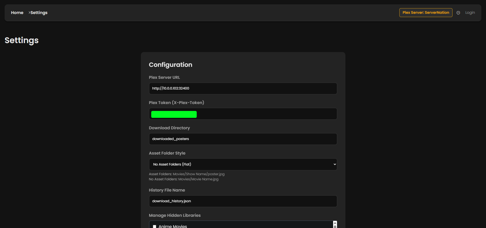
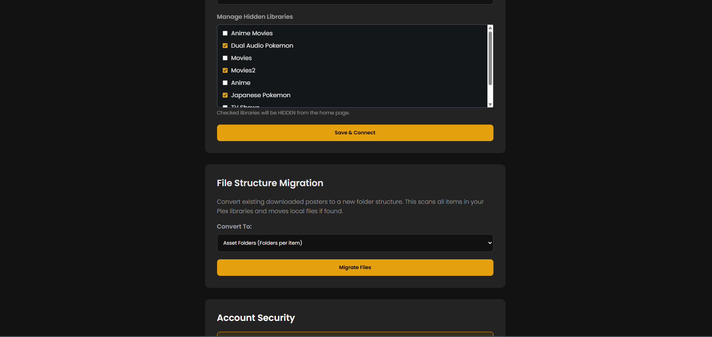
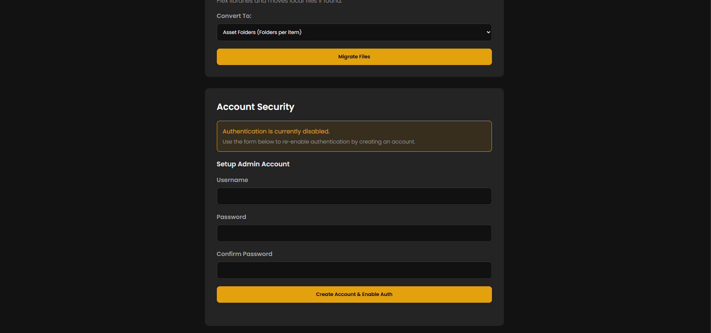
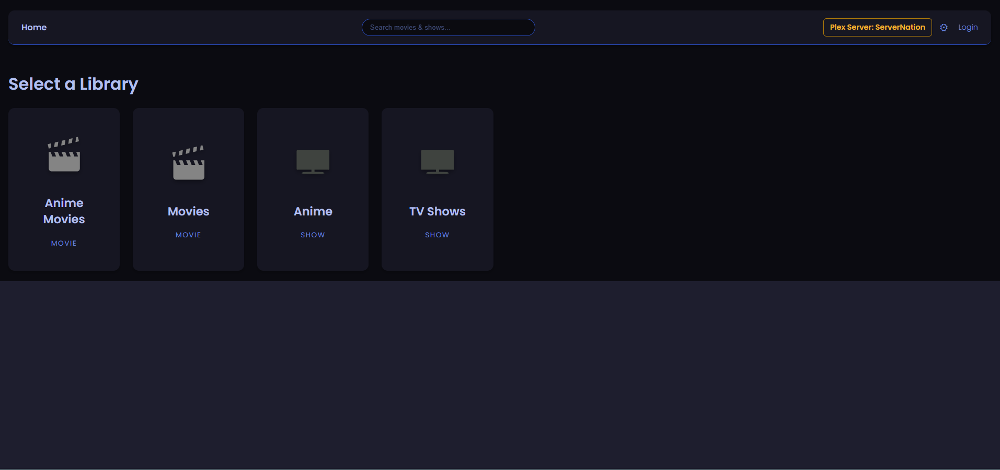
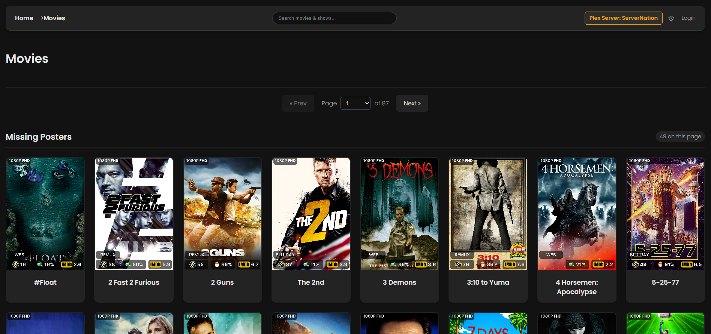
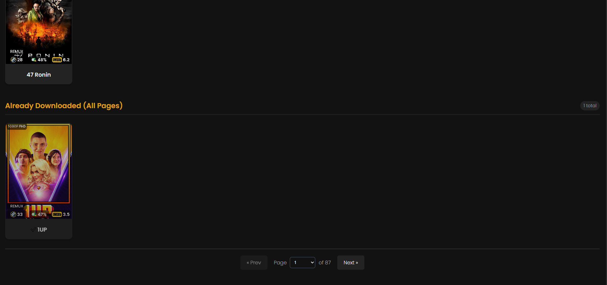
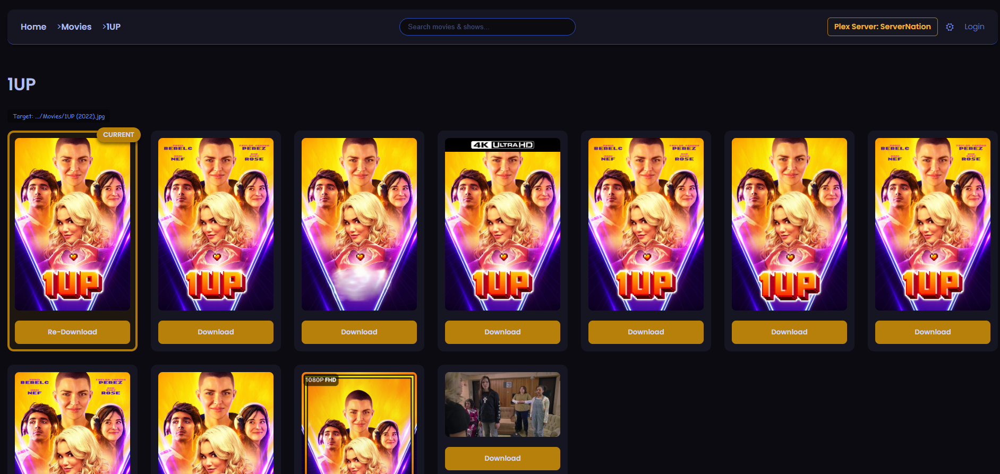
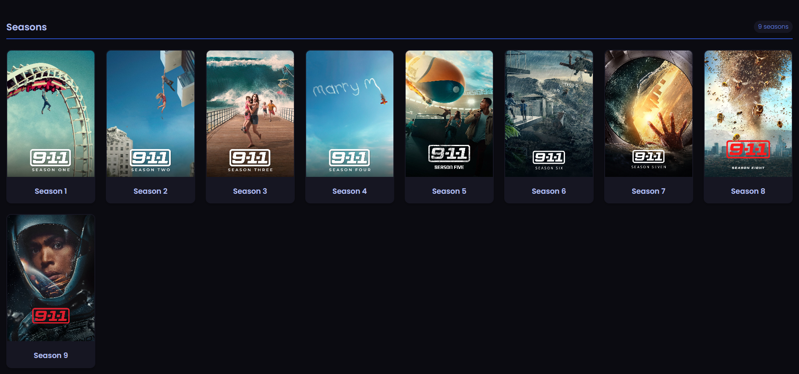
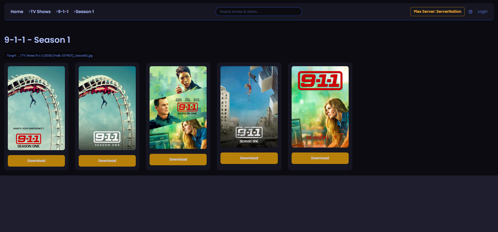

## 🎬 Plex Poster Downloader & Manager

A self-hosted web application that allows you to easily browse your Plex libraries and download local poster artwork (poster.jpg) and backgrounds (background.jpg) to any local folder.

This tool is perfect for users who want to switch to "Local Assets" agents, use tools like Kometa (formerly PMM), or simply want a backup of their curated artwork stored alongside their media files.

## **AI WARNING**
THIS SCRIPT WAS GENERATED USING GOOGLE GEMINI! I KNOW THIS CAN BE A TURN OFF FOR SOME BUT HAS BEEN TESTED AND WORKS GREAT! JUST GIVING THIS WARNING NOW AS I KNOW SOME DONT LIKE AI MADE SCRIPTS
YOU HAVE BEEN WARNED.

## ✨ Features

* **Plex-Themed Web UI:** A dark, responsive interface designed to feel like home for Plex users.

* **Global Search:** Instantly search for movies or shows across all libraries with autocomplete suggestions.

* **Posters, Backgrounds & Clearlogos:** Dedicated artwork tabs combine Plex sources with optional direct provider results.

    * Download high-res backgrounds for Movies, Shows, and Seasons.

    * Origin badges distinguish `tmdb_plex` (returned by Plex) from `tmdb` (queried directly); equivalent labels apply to other providers.

    * Clearlogos are normalized to transparent-capable PNG files: `Library/Show Name/clearlogo.png` or flat `Library/Show Name_clearlogo.png`. Season logos use `Season01_clearlogo.png` when a source supplies them. Episode titlecards do not substitute show logos or covers.

* **Hide Uploaded Posters:** Enable "Hide uploaded posters" in Settings to hide choices labeled Upload for movies, shows, seasons, and episode titlecards. Disabled by default; backgrounds and existing files are unchanged.

* **Previous/Next Navigation:** Move between movies or shows directly from the poster selection page in the same library's title order, including across library pages. Buttons are disabled at the first and last item.

    * Seasons follow season-number order within the show; episodes follow episode-number order within the season.

* **Season Posters & Episode Titlecards:** Open a show, select a season, then select an episode to download its titlecard. Titlecards use landscape previews and the same source validation and download history as posters.

    * Asset Folders: `Library/Show Name/Season01.jpg` and `Library/Show Name/S01E02.jpg`.

    * Flat: `Library/Show Name_Season01.jpg` and `Library/Show Name_S01E02.jpg`.

    * Specials use season zero (`Season00.jpg`, `S00E01.jpg`).

* **Automated Scheduler (Cron):**

    * Schedule daily or weekly downloads (e.g., "Every Friday at 3:00 AM").

    * Choose specific libraries to target.

    * Modes: Random (fill missing spots), Specific Provider, or Random Provider.

    * Option to auto-download backgrounds alongside posters.

    * Separate opt-in settings for **Download Season Posters**, **Download Episode Titlecards**, and **Download Clearlogos**. Existing schedules remain unchanged until enabled.

    * Child artwork uses the same library filters and provider selection. Existing files are skipped, but missing child artwork is still downloaded when the show poster already exists. Uploaded sources are excluded from scheduled downloads.

    * Background downloads include enabled seasons, not episodes.

* **Flexible Asset Structures:** Support for both Asset Folders and Flat naming conventions.

* **Migration Tool:** Built-in utility to scan and convert your existing downloaded posters between folder structures.

* **Download Tracking:**

    * **Green (✅):** Poster already downloaded.

    * **Yellow (⚠️):** Partial download (e.g., Show has a poster but seasons are missing, or vice versa).

    * **Standard:** Poster missing.

* **Library Management:**

    * Supports Movies and TV Shows.

    * Paginated views for large libraries.

    * **Hidden Libraries:** Easily hide specific libraries (like 4K or Home Videos) via the Settings checklist.

* **Authentication:** Secure the interface with an admin username/password (can be disabled in Settings).

* **Manual Override:** Toggle items as "Complete" manually if you don't want to download a poster for them.

## Direct provider setup and anime mapping

In Settings, enter any providers you want to query directly:

* **TMDB:** v3 API key or API read access token.
* **TheTVDB:** v4 API key and, if required for your subscription, subscriber PIN.
* **fanart.tv:** API key. Movie artwork uses a TMDB/IMDb ID; TV artwork uses a TVDB ID.
* **MyAnimeList:** Client ID from a registered API application.
* **AniList:** Public anime cover queries need no API key.
* **AniDB:** Registered/approved HTTP API client name and client version, not your AniDB username/password.

API credentials are encrypted with the instance key, never rendered back into the settings form. Leave a field blank to retain its value; use its removal checkbox to clear it. Keep both `config.json` and `.secret.key` when moving the instance. Provider failures appear as notices without replacing available Plex artwork. Follow the provider's registration, attribution, subscription, and usage terms.

Mark the appropriate **Anime Libraries** in Settings. Anime lookups run only for those libraries. Enable automatic mapping to use the Anime-Lists per-season crosswalk and Fribb's anime-entry ID bridge. AniList's `idMal` relationship also links matching AniList/MAL entries. Mapping metadata is cached for a day; successful AniDB responses are cached for seven days and its requests are spaced by at least two seconds. The cache lives in `DATA_DIR/.anime-provider-cache`.

Expand **Artwork IDs** on a movie, show, or season to override IDs. TMDB/TVDB IDs refer to the movie or parent series. AniDB/AniList/MAL overrides refer to the exact anime entry for that item. A season never inherits its show's anime ID. Split cours, absolute-order mappings, or other ambiguous results require an explicit season override rather than guessing. Blank overrides restore detected/mapped IDs. Episode titlecards use episode stills, not anime cover posters.

Provider IDs are detected from Plex GUIDs when available. TMDB/TVDB external-ID endpoints can resolve additional IDs when the corresponding credentials exist; no fuzzy title-based matching is performed. Only artwork actually returned for the requested scope is offered, so some providers/items have no season logos or episode stills.

Downloads use provider-returned image choices, not arbitrary submitted URLs. Direct image URLs are restricted to known provider CDNs; redirects and oversized downloads are rejected. Failed transfers or invalid clearlogos do not overwrite an existing asset. Scheduled downloads use the same sources and ID overrides as the picker and still skip existing files. In the schedule provider selector, `tmdb`/`tvdb` match the provider regardless of origin; `tmdb_plex`/`tvdb_plex` restrict it to Plex-origin artwork.

This product uses the TMDB API but is not endorsed or certified by TMDB. Artwork remains credited to its original providers, including TheTVDB, fanart.tv, AniList, MyAnimeList, and AniDB; mapping data comes from Anime-Lists and Fribb/anime-lists.

## Tests

Run `python -m unittest discover -s tests -v` after installing requirements. API adapter tests use controlled responses and do not require real credentials. To include Docker runtime dependency checks, build an image and run `TEST_IMAGE=<image-tag> python -m unittest discover -s tests -v`. Live authenticated provider access requires your own configured keys and is separate from the offline tests.

## **📷Screenshots**

* **Settings**




* **Homepage**


* **Library**


* **Posters**





## **🐳 Docker Installation (Recommended)**

The easiest way to run this application is using Docker.

# **Prerequisites**

  * **Docker**

  * **Docker Compose**

**1. Create Project Directory**

Create a folder on your server and place the ``compose.yaml`` file inside it.

**2. Configure Volumes**

Open ``compose.yaml`` and ensure the volumes map to your actual media folders.

```
services:
  plex-poster-downloader:
    image: ghcr.io/johnfawkes/plex-poster-downloader:latest
    container_name: plex-poster-manager
    restart: unless-stopped
    ports:
      - "5015:5000"
    volumes:
      # Stores config.json and download history
      - ./config:/app/config
      # If using with Kometa, change the first downloaded_posters to the asset directory for kometa
      - ./downloaded_posters:/app/config/downloaded_posters
    environment:
      - DATA_DIR=/app/config
      - PUID=1000  # run `id -u` on your host to get your UID
      - PGID=1000  # run `id -g` on your host to get your GID
```

**3. Run the Container**

```
docker-compose up -d
```

**4. Access the UI**

Open your browser and navigate to: ``http://localhost:5015``

## 🐍 **Manual Installation (Python)**

If you prefer running it directly on your host machine without Docker.

**Prerequisites**

  * Python 3.11 or higher

  * ``pip``

 **Steps**

  1. **Clone the Repository**

```
git clone https://github.com/johnfawkes/plex-poster-downloader.git
cd plex-poster-downloader
```

  2. **Install Dependencies**

```
pip install -r requirements.txt
```

***(Note: Create a virtual environment first if preferred)***

  3. **Run the Script**

```
python plex_poster_downloader.py
```

  4. **Access the UI** Open ``http://localhost:5015`` in your browser.

## **⚙️ Configuration**

On the first launch, you will be redirected to the Settings page.

  1. **Authentication:** You will be asked to create an Admin Username and Password.

  2. **Plex Connection:**

        * **Plex Server URL:** e.g., ``http://192.168.1.10:32400``

        * **Plex Token:** Your X-Plex-Token. [How to find your token.](https://support.plex.tv/articles/204059436-finding-an-authentication-token-x-plex-token)

  3. **Hidden Libraries:** You can uncheck libraries you don't want to manage (e.g., Home Videos, Music).

## 📂 **Folder Structure Logic**

This tool supports two different naming conventions for saving posters. You can switch between them in Settings and use the Migrate Files tool to automatically reorganize your existing downloads.

1. **Asset Folders:**

    * **Movies:** ``[BaseDir]/Library Name/Movie Name/poster.jpg``

    * **Shows:** ``[BaseDir]/Library Name/Show Name/poster.jpg``

    * **Seasons:** ``[BaseDir]/Library Name/Show Name/Season01.jpg``

2. **No Asset Folders (Flat):**

    * **Movies:** ``[BaseDir]/Library Name/Movie Name.jpg``

    * **Shows:** ``[BaseDir]/Library Name/Show Name.jpg``

    * **Seasons:** ``[BaseDir]/Library Name/Show Name_Season01.jpg``

***Note: The script creates folders if they don't exist.***

## 🛠️ **Troubleshooting**

**Login loop or Session errors:**
The app generates a new secret key on every restart for security. If you restart the container, you will need to log in again.

## **Future Plans**

* Add support for titlecards
* Add support for logos
* Add Squareart support
* ~~Add support for backgrounds~~
* Maybe add manual upploading of assets to the webui for ease of use when you may not have access to the internal filesystem to place them manully
* Add a viewer for just the locally downloaded posters. Seperate it out from the downloader
